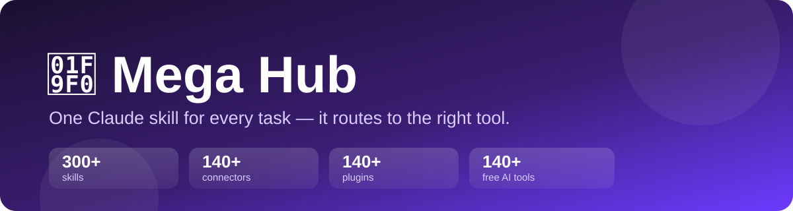

<div align="center">



# 🧰 Mega Hub

### One Claude skill that routes any task to 300+ skills, 140+ connectors, 140+ plugins & 140+ free AI tools


[](https://github.com/puribaba007/mega-hub-skill/releases/latest)
[](https://github.com/puribaba007/mega-hub-skill/actions/workflows/validate.yml)
[](https://github.com/puribaba007/mega-hub-skill/stargazers)

**[Install](#install-2-minutes) · [What's inside](#whats-inside) · [How it works](#good-to-know) · [Contribute](CONTRIBUTING.md)**

⭐ **If this saves you time, star it** — it helps others find it.

</div>

---

> **One install. Every tool.** Mega Hub sends any task — CEO/C-suite work, marketing, YouTube,
> social media, trading, finance, data, coding, DevOps, design, 3D/graphics, video, audio,
> Google Workspace and documents — to the right skill, connector or free tool. **Free options come first.**

Ships with a second skill, **`code-forge`**: rebuild a UI from a URL (Replica), authorized
reverse engineering / CTF, and competitive programming (Codeforces, LeetCode, AtCoder).

## What's inside

| File | Contents |
|---|---|
| `mega-hub/SKILL.md` | Router: role → best skill + connector, ready-made pipelines |
| `code-forge/SKILL.md` | Advanced coding skill: Replica (UI rebuild), authorized reverse engineering/CTF, competitive programming (Codeforces/LeetCode), pro workflow |
| `references/skills-catalog.md` | 300+ skills by category |
| `references/connectors.md` | 140+ real MCP connectors with URLs |
| `references/plugins-and-repos.md` | 140+ plugins + install pattern |
| `references/free-ai-tools.md` | 140+ free / open-source tools (video, 3D, graphics, LLMs, coding) |
| `scripts/install.ps1`, `install.sh` | One-shot plugin installer (dry run by default) |

## Install (2 minutes)

**Windows (PowerShell)**
```powershell
git clone https://github.com/<your-username>/mega-hub-skill
Copy-Item -Recurse mega-hub-skill\mega-hub "$HOME\.claude\skills\mega-hub"
Copy-Item -Recurse mega-hub-skill\code-forge "$HOME\.claude\skills\code-forge"
powershell -ExecutionPolicy Bypass -File "$HOME\.claude\skills\mega-hub\scripts\install.ps1" -Apply
```

**Mac / Linux**
```bash
git clone https://github.com/<your-username>/mega-hub-skill
cp -r mega-hub-skill/mega-hub ~/.claude/skills/mega-hub
cp -r mega-hub-skill/code-forge ~/.claude/skills/code-forge
bash ~/.claude/skills/mega-hub/scripts/install.sh --apply
```

**claude.ai / Claude desktop app:** zip the `mega-hub` folder and upload it in
Settings → Capabilities → Skills.

Then just ask Claude: *"mega hub: make a YouTube video about X"* or *"which tool should I use to …"*.

## Good to know
- This is a **router + catalog**, not a copy of other people's code. It points to each original
  skill/plugin so you always get their latest version, and their licenses stay respected.
- Skills from optional plugins work only after that plugin is installed (the installer adds the core ones;
  the catalog lists where the rest come from).
- Connectors are free to connect, but each needs your own sign-in, and some services have paid plans.
  Add them in Claude → Settings → Connectors.
- No passwords or API keys are stored in this repo.

## Contributing
PRs welcome — add a tool, fix a name/URL, or improve the router. See [CONTRIBUTING.md](CONTRIBUTING.md),
the [Code of Conduct](CODE_OF_CONDUCT.md) and [Security policy](SECURITY.md). Ideas and questions →
[Discussions](https://github.com/puribaba007/mega-hub-skill/discussions).

## Star history
[](https://star-history.com/#puribaba007/mega-hub-skill&Date)

## License
MIT. See [`LICENSE`](LICENSE). Listed third-party skills, plugins and tools keep their own licenses.
